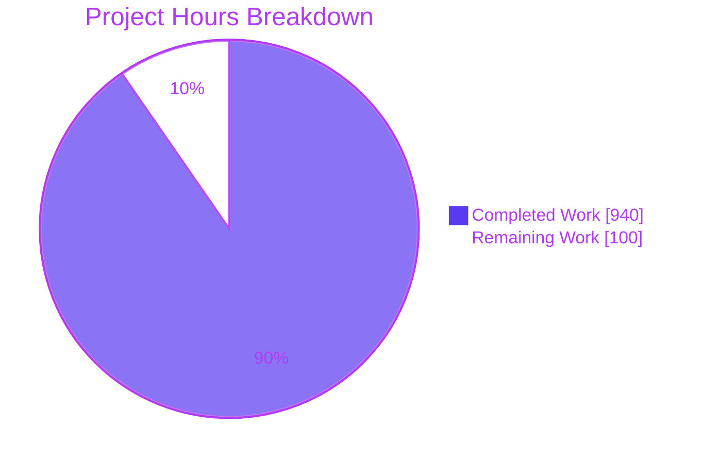
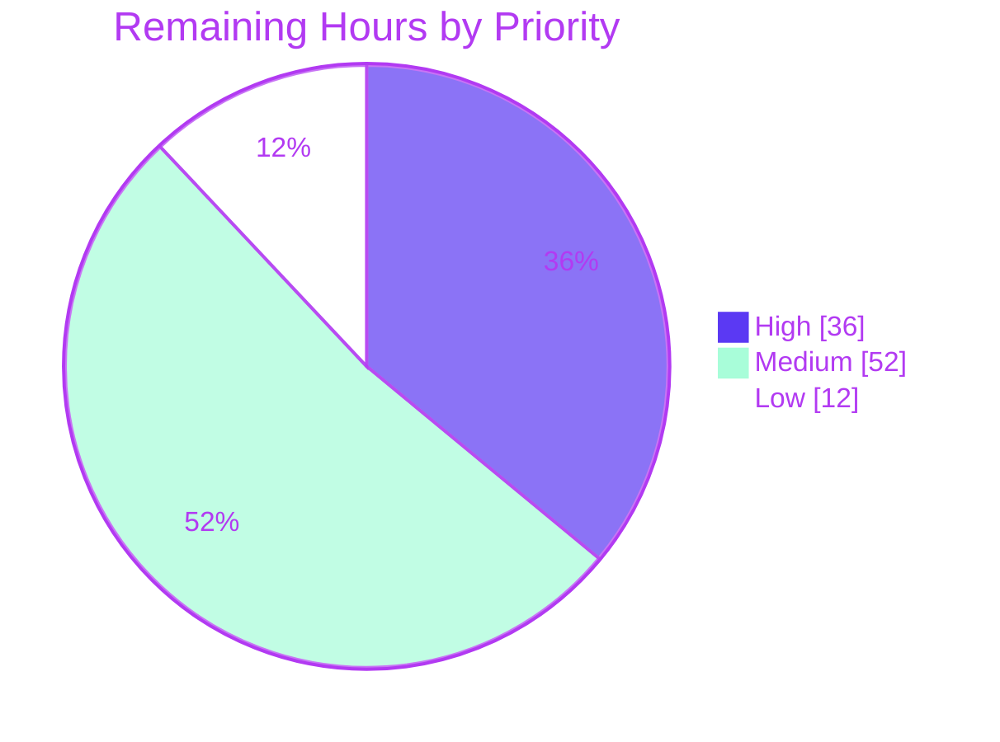

# 1. Executive Summary

## 1.1 Project Overview

Erewhon is a JADE 2022 system whose REST service (port 65000, 13 operations) and SOAP service (port 21001, 9 operations) are used by existing callers. This project places an ASP.NET Core 10 strangler facade in front of those 22 operations without moving any behaviour out of JADE. Every call is forwarded byte for byte to the target its configuration names, so later increments can move one operation at a time. A deterministic JADE stand-in, a committed behaviour baseline and an equivalence harness prove the facade changes nothing, and `docker compose up --build` runs that proof end to end. The audience is the team planning the JADE migration and the operators who will cut callers over.

## 1.2 Completion Status


| Metric | Value |
|---|---|
| Total Hours | 1,040 |
| Completed Hours (AI + Manual) | 940 (940 AI + 0 manual) |
| Remaining Hours | 100 |
| Percent Complete | 90.4% |

940 hours completed out of 1,040 total hours = 90.4% complete.

## 1.3 Key Accomplishments

- ✅ All 22 operations served at their existing addresses; 56 of 56 baseline cases reproduce exactly through the facade.
- ✅ Byte-faithful forwarding with per-operation routing, validated at start-up and resolved per request.
- ✅ Facade-only failure responses (REST 502/504 problem+json, SOAP 500 Fault) verified in 7 of 7 cases.
- ✅ Admin listener (9090) isolated by socket, not by `Host` header: 15 of 15 isolation cases pass.
- ✅ Deterministic JADE stand-in ported from the reference method bodies and transaction-agent rules.
- ✅ OpenAPI 3.1.1 and WSDL contracts checked in, each drift-checked on every replay.
- ✅ One command (`docker compose up --build`) and a Docker-less fallback both end with `RESULTS.md` and the harness's exit status.
- ✅ 3,089 automated tests pass (2,485 harness, 604 facade); nothing under `Erewhon/` changed (227 of 227 paths).

## 1.4 Critical Unresolved Issues

4 items remain open. Of the 40 requirements in the plan, 1 is partially met (ordering evidence); of the 22 operations and 56 cases, none differs. The other 3 are accepted caveats or capabilities never exercised against live JADE.

| Issue | Impact | Owner | ETA |
|---|---|---|---|
| Ordering evidence fails (1 of 9 checks in `RESULTS.md`): facade project and lock files (`ccf8091`, `dbf83d0`) precede baseline commit `243bb78` | Capture-before-build provenance not literally met; registered as `KL-CHK-ORDERING` (see 5.2) | Tech lead | 4 h |
| Equivalence never exercised against live JADE | All 22/22 results rest on the stand-in (`KL-BASELINE-STANDIN`); production equivalence unproven | JADE platform team | 32 h |
| Tender seed load: 100 tenders and 1 tender sale instead of 160 and 4; `getAllSales` returns 20 sales, not 23 | Baseline encodes the code's reading (`KL-STANDIN-TENDER-LOAD`, see 5.2) | Domain owner | 10 h |
| Five facade edge behaviours accepted (CONNECT, lower-case `head`, paused uploads over 16 MiB, request heads over 1 MiB, 100-Continue then rejection) | Uncharacterised traffic only; none of the 56 cases (see 5.2) | Facade owner | 4 h |

## 1.5 Access Issues

| System/Resource | Type of Access | Issue Description | Resolution Status | Owner |
|---|---|---|---|---|
| JADE 2022 runtime (`ErewhonREST` :65000, `WebServiceHTTP` :21001) | Runtime and network access | No JADE installation or endpoint is reachable from the build environment, so capture and replay ran against the stand-in only | Unresolved | JADE platform team |

## 1.6 Recommended Next Steps

1. [High] Decide `KL-CHK-ORDERING`: accept the documented exception, or rebase so the facade project files follow the baseline commit, then rerun the gate.
2. [High] Provision live JADE 2022 on a fresh database and run capture and replay through the facade in external-backend mode.
3. [Medium] Sign off stand-in fidelity (tender load, assumed REST paths, SOAP actions and WSDL) and re-capture any correction.
4. [Medium] Add a CI gate and a production deployment that publishes only 65000/21001 and keeps 9090 internal.
5. [Medium] Settle the five facade edge behaviours with consumers.

# 2. Project Hours Breakdown

## 2.1 Completed Work Detail

| Component | Hours | Description |
|---|---|---|
| Operation catalogue and shared contracts library | 60 | `contracts/operation-catalogue.json` (22 operations, DTOs, status constants, reachability) and `contracts/src/Erewhon.Contracts` (catalogue loader, REST matcher, SOAP resolver, listener policy, wire formats, seed fingerprint, labels) |
| JADE stand-in service | 130 | `standin/src/Erewhon.StandIn`: Windows-1252 seed loader and tokenizer, model and transaction-agent validation with exact messages, DTO builder, REST and SOAP surfaces, WSDL generator, deterministic GUIDs and clock, admin reset/info/shutdown |
| Behaviour baseline and case matrix | 28 | 56-case matrix (36 REST, 20 SOAP), 60 baseline records including 4 binary `getPhoto` bodies, manifest, published WSDL, conformance result, labelled baseline commits |
| Harness comparison engine | 70 | JSON, XML and binary comparers, response comparer and N1/N2 normaliser (`harness/src/Erewhon.Harness/Compare`) |
| Harness baseline store, runner, lifecycle and modes | 120 | Confined baseline store, case runner, readiness/reset/shutdown clients, `capture`, `replay`, `export-openapi` and `summary` modes, options and entry point |
| Harness checks, register and results report | 90 | Conformance, OpenAPI drift, WSDL contract, JADE-unchanged, ordering and facade-TRX checks; failure identities and signatures; 26-entry known-limitations register; `RESULTS.md` writer |
| Harness test suite | 100 | 2,485 tests in the six planned classes under `harness/tests/Erewhon.Harness.Tests` |
| Facade forwarding core | 110 | `BackendForwarder.cs` and `PassThroughTransformer.cs`: YARP pass-through, per-target invokers, deadlines, 502/504/Fault mapping, early answers, trailer relay, outcome logging |
| Facade routing, endpoints, admin, OpenAPI and WSDL | 64 | Validated routing options and per-request router, REST/SOAP endpoints and catch-alls, admin listener, catalogue-driven OpenAPI transformers, WSDL address rewrite, composition root |
| Facade test suite | 72 | 604 tests in `RoutingTests.cs`, `FailureBehaviourTests.cs`, `ListenerIsolationTests.cs` and two support files on real loopback Kestrel listeners |
| Containers, Compose and run scripts | 44 | Three Dockerfiles, five-service `docker-compose.yml` with exit-status chain, `.env`, `facade/tests/run-tests.sh`, `harness/scripts/run-local.sh` |
| Build pins and restore reproducibility | 8 | Component `global.json` files, `Erewhon.Strangler.props`, central package versions, lock files, locked-mode restore |
| End-to-end verification, security and runtime validation | 44 | Compose and local-process replays, the three exit-code verification runs, credential redaction, path confinement, admin containment and vulnerability checks |
| **Total** | **940** | |

## 2.2 Remaining Work Detail

| Category | Hours | Priority |
|---|---|---|
| Ordering evidence: accept `KL-CHK-ORDERING` or rebase so facade project files follow baseline commit `243bb78`; rerun the gate | 4 | High |
| Live JADE capture and replay through the facade (fresh database, external-backend mode, difference triage) | 32 | High |
| Stand-in fidelity sign-off against JADE (tender load, `KL-REST-PATHS`, `KL-SOAP-ACTIONS`, `KL-SOAP-WSDL`, other 0.7.2 assumptions) and re-capture | 10 | Medium |
| Run the JADE unit tests on the live system (`KL-JADE-TESTS-NOT-RUN`) | 4 | Medium |
| Production deployment and port cut-over (facade image, JADE moved to internal addresses, 9090 unpublished, rollback) | 20 | Medium |
| CI pipeline: builds, both test suites, locked restore, vulnerable-package scan, Compose replay | 8 | Medium |
| Monitoring and alerting on per-call outcomes and `/health` | 6 | Medium |
| Facade edge-behaviour decisions (CONNECT, lower-case `head`, 16 MiB padding bound, 1 MiB request head, 100-Continue abort) | 4 | Medium |
| Load and resilience test against live JADE | 8 | Low |
| Code residue: guard the stand-in banner write, `nosniff` on server-generated admin errors, register the 32 MiB evidence cap | 4 | Low |
| **Total** | **100** | |

## 2.3 Hours Calculation

- Completed hours: 60 + 130 + 28 + 70 + 120 + 90 + 100 + 110 + 64 + 72 + 44 + 8 + 44 = **940**
- Remaining hours: 4 + 32 + 10 + 4 + 20 + 8 + 6 + 4 + 8 + 4 = **100**
- Total project hours: 940 + 100 = **1,040**
- Completion: 940 / 1,040 × 100 = **90.4%**
- Of the 40 plan requirements, 39 are Completed, 1 is Partially Completed (ordering evidence) and none is Not Started. The live-JADE, deployment, CI, monitoring and load items are path-to-production work.
- Confidence: high for the ordering, CI, edge-decision and residue items; medium for fidelity, deployment and monitoring; low for live-JADE capture, which depends on a JADE environment with a resettable database.

# 3. Test Results

All figures below come from runs at the delivered commit on SDK 10.0.403 / runtime 10.0.14: both test projects in Release, and one full `docker compose up --build` replay. The plan defines no code-coverage tool; plan coverage is the harness's own measure (22 operations, 56 cases).

| Area / Category | Framework | Tests | Passed | Failed | Coverage | What This Proves |
|---|---|---|---|---|---|---|
| Harness: comparers, normaliser, baseline evidence (`BinaryComparerTests`, `JsonSemanticComparerTests`, `XmlSemanticComparerTests`, `NormaliserTests`) | xUnit v3 4.0.2 on Microsoft.Testing.Platform | 1,379 | 1,379 | 0 | n/a | JSON, XML and binary bodies are compared as the plan specifies, and N1/N2 only ever match valid typed values pairwise |
| Harness: register, checks, report, case model (`KnownLimitationsRegisterTests`) | xUnit v3 4.0.2 | 607 | 607 | 0 | n/a | Failures are documented only by an exact (`itemId`, `nature`) match, and check verdicts and `RESULTS.md` render correctly |
| Harness: replay lifecycle, modes, CLI (`ReplayLifecycleTests`) | xUnit v3 4.0.2 | 499 | 499 | 0 | n/a | Every exit path writes or prints the report, shuts components down and exits 0 or 1 |
| Facade: routing, pass-through, SOAP resolution, WSDL dispatch, configuration lifecycle (`RoutingTests.cs`) | xUnit v3 4.0.2 + Mvc.Testing on real Kestrel | 220 | 220 | 0 | n/a | Rerouting one operation leaves the other 21 untouched, and requests and responses cross the facade unchanged |
| Facade: failure behaviour and transport (`FailureBehaviourTests.cs`) | xUnit v3 4.0.2 + Mvc.Testing | 369 | 369 | 0 | n/a | Unreachable and timed-out backends get the specified 502/504/Fault within the bounds; backend errors pass through verbatim |
| Facade: listener isolation (`ListenerIsolationTests.cs`) | xUnit v3 4.0.2 + Mvc.Testing | 15 | 15 | 0 | n/a | Admin endpoints answer only on the admin socket, whatever `Host` header a caller forges |
| Equivalence replay through the facade (Compose) | Harness `replay` | 56 cases | 56 | 0 | 22 of 22 operations | Every recorded stand-in response is reproduced exactly through the facade |
| Replay checks: conformance, OpenAPI drift, WSDL contract, JADE unchanged, ordering | Harness `replay` | 5 | 4 | 1 | 216 members; 227 paths | Contracts and `Erewhon/` are unchanged and stand-in conformance holds (117 members observed, 99 registered unreachable); ordering evidence fails, as `KL-CHK-ORDERING` documents |

**Not Covered**

- **Live JADE.** No test or replay runs against JADE; every equivalence result compares the facade with the stand-in. Capture and replay against JADE before cut-over.
- **Stand-in internals.** The stand-in has no unit-test project, because the plan includes none. It is exercised only through the 56 replay cases and the conformance check. Seed edge cases (malformed lines, other encodings) need direct tests if the stand-in is extended.
- **External-backend mode.** Running with `COMPOSE_PROFILES=` and an empty `BACKEND_ADMIN_URL` (no reset, no seed confirmation) has no automated test. Exercise it against the real backend.
- **JADE's own unit tests** were not run (`KL-JADE-TESTS-NOT-RUN`).
- **Performance.** Neither suite measures latency or throughput, so run a load test against live JADE before production.

# 4. Runtime Validation & UI Verification

The project has no user interface; its surfaces are HTTP. Each line below was driven directly: the Compose stack, the local-process fallback, and the stand-in and facade as host processes.

- ✅ **One-command run.** `docker compose up --build` (with a host-port override) exited 0. All five containers exited 0, the facade tests passed 604 of 604 in-container, and `RESULTS.md` was regenerated ending "22 of 22 operations equivalent, 0 documented differences".
- ✅ **Docker-less fallback.** `harness/scripts/run-local.sh replay` in a loopback-only namespace exited 0. It built 4 projects, ran the facade tests (604/604) and replayed 56/56 cases, then stopped both processes (`POST 202`, connection refused).
- ✅ **Start-up and admin.** `/health` returns `ok`. Facade `/admin/info` reports `.NET 10.0.14`, `wsdl: present` and the 22-entry routing table. `/openapi/v1.json` is OpenAPI 3.1.1, "Erewhon REST facade" 1.0.0, with no `servers`.
- ✅ **REST forwarding.** `GET /agent/Hank%20Williams` returns 200 `application/json`, byte-identical to the stand-in's direct answer. `/agent/Nobody%20Agent` passes through as `null` 404.
- ✅ **SOAP forwarding and WSDL.** `getAgentNames` returns the stand-in envelope. The published WSDL's `soap:address/@location` is rewritten to the caller's host.
- ✅ **Unreachable backend.** With the stand-in stopped, REST gets 502 `application/problem+json` "The backend for operation getAllAgents could not be reached." and SOAP gets HTTP 500 with a `soap:Server` "Backend unavailable" Fault.
- ✅ **Listener isolation.** A forged `Host: <host>:<admin port>` on the REST socket reaches the REST catch-all (404), never the admin endpoint.
- ✅ **Per-call logging.** One JSON line per call carries surface, operation, target, status, duration and outcome (`forwarded`).
- ✅ **State reset.** The stand-in resets to empty (generation 3) before the empty-state case and back to seed (generation 4) after it, and the seed SHA-256 and reference date are confirmed at each reset.
- ⚠ **Never exercised at runtime:** a live JADE backend, external-backend mode without reset, and any deployment beyond Compose or local processes. There is no authentication flow to drive, because the plan keeps the system unauthenticated, as JADE is today.

# 5. Compliance & Quality Review

## 5.1 Compliance Matrix

| Deliverable (plan section) | Benchmark | Status | Progress |
|---|---|---|---|
| Baseline captured before facade code (0.5.4, 0.7.4) | 56/56 records labelled `jade-standin`; ordering check | ⚠ Partial: records complete, ordering check fails | 🟪🟪🟪🟪⬜ 90% |
| Facade serves 22 operations byte-faithfully (0.3.2.1) | 22/22 operations equivalent on replay | ✅ Pass | 🟪🟪🟪🟪🟪 100% |
| Per-operation routing (0.3.2.2) | Start-up validation; routing tests 2/2 | ✅ Pass | 🟪🟪🟪🟪🟪 100% |
| Facade-only failure behaviour (0.3.2.1) | Exact 502/504/Fault bodies; failure 7/7 | ✅ Pass | 🟪🟪🟪🟪🟪 100% |
| Listener isolation and admin listener (0.3.2.1, 0.4.1) | 15/15 cases; 9090 never published | ✅ Pass | 🟪🟪🟪🟪🟪 100% |
| OpenAPI and WSDL contracts (0.7.8) | Drift and contract checks | ✅ Pass | 🟪🟪🟪🟪🟪 100% |
| JADE stand-in fidelity (0.3.2.3, 0.9) | Conformance 117 + 99 registered of 216; seed tokens 2/2 | ✅ Pass, with registered tender-load divergence | 🟪🟪🟪🟪🟪 100% |
| Harness, normalisation and register (0.3.2.4, 0.7.5–0.7.7) | 2,485/2,485 tests; every failing item documented | ✅ Pass | 🟪🟪🟪🟪🟪 100% |
| Results report and exit code (0.8.2–0.8.4) | Report structure; exit 0 clean, exit 1 on forced 502 and failed report write | ✅ Pass | 🟪🟪🟪🟪🟪 100% |
| Containers and one command (0.3.2.5, 0.8.1) | Five services, exit chain, local fallback | ✅ Pass | 🟪🟪🟪🟪🟪 100% |
| Pins, reproducibility and dependency security (0.6) | SDK 10.0.403 / runtime 10.0.14; locked restore; no vulnerable packages in 5 projects | ✅ Pass | 🟪🟪🟪🟪🟪 100% |
| No change to existing files (0.2.2, 0.11.1) | `Erewhon/` 227/227 unchanged; 193 files added, 0 modified | ✅ Pass | 🟪🟪🟪🟪🟪 100% |

## 5.2 AAP & Rule Divergences and Gaps

The plan sets no user rules (0.10); every divergence below is measured against the plan itself.

| What the AAP/Rule Required | What Was Delivered Instead | Why It Diverged | Impact | Remediation |
|---|---|---|---|---|
| Baseline commit precedes every `facade/` path; ordering check passes (0.5.4 Rule 5, 0.7.8) | Facade project and lock files committed in `ccf8091`/`dbf83d0` before baseline `243bb78`; check fails `not-ancestor` | All project files were created first to restore and lock packages; rewriting history was not done | Provenance only; no facade code preceded capture | Accept `KL-CHK-ORDERING` or rebase (4 h) |
| 160 tenders and 4 tender sales; `getAllSales` returns 23 (0.9.4, 0.7.3) | 100 tenders, 1 tender sale; `getAllSales` returns 20 | Sanctioned by plan Rule 4: the stand-in follows the transaction-agent closure rule | Baseline encodes the code's reading | Confirm against live JADE (10 h) |
| `dotnet test … -- --report-xunit-trx … --results-directory <dir>`; `ENTRYPOINT tests/run-tests.sh` (0.5.1) | TRX options passed without `--`; entrypoint `["/bin/bash","/src/facade/tests/run-tests.sh"]` | SDK 10.0.403 rejects the planned form and writes no TRX | None; TRX produced and read | None |
| Every authored file named in the plan; three facade test classes, six harness classes (0.3.1, 0.5.1, 0.5.3) | Exactly the planned files, holding 15 facade test classes and nested helpers | Extra coverage kept inside planned files so file inventory and check counts stay exact | Very large files | Optional split later |
| Log outcome `forwarded`, `unavailable` or `timeout` (0.3.2.1) | Adds `aborted` and `failed` (status 0) | Rule 3 forbids re-heading a started response; three values could not describe those calls | Log consumers see five values | Alert on all five (6 h) |
| No behaviour change; everything else passes verbatim (0.11.1, Rule 3) | Five edge behaviours answered by the facade or server | YARP and Kestrel limits, plus a 16 MiB memory bound | Uncharacterised traffic only | Decide with consumers (4 h) |
| Stand-in changes only before the baseline commit (0.7.7) | Stand-in changed after `243bb78`; baseline re-captured byte-identically | The 0.11.2 re-capture and registration procedure was applied | None on records; provenance explicit | None |
| Full discrepancy list written for each failing item (0.7.7) | Evidence capped at 32 MiB per comparison, without a register entry | Bounds memory on pathological bodies | Only bodies far beyond characterised sizes | Register the cap (within 4 h residue) |

**Ordering evidence.** Plan Rule 5 requires the baseline commit to come before any `facade/` file, and the ordering check (`harness/src/Erewhon.Harness/Checks/OrderingEvidence.cs`) requires the ancestor relation to hold. Commits `ccf8091` and `dbf83d0` added `facade/src/Erewhon.Facade/Erewhon.Facade.csproj`, the facade test project and their `packages.lock.json` files before baseline commit `243bb78`, because every component's project and lock files were created first so packages could be restored and locked. No facade source existed until `455d191`. Making the check pass needs rewritten branch history, which was not done. `RESULTS.md` line 65 shows the failure, and `KL-CHK-ORDERING` (`harness/config/known-limitations.json`) documents it, so the harness exits 0. Decide whether to accept the exception or rebase before merge.

**Tender seed load (sanctioned).** Plan 0.9.4 and 0.7.3 state 160 tenders, tender sales for items 70, 80, 92 and 106, and 23 sales from `getAllSales`. `standin/src/Erewhon.StandIn/Seed/SeedLoader.cs` loads through the tender transaction agent, which treats an item as closed when its closure date precedes the load date. It therefore rejects 60 seed rows (`Erewhon/DataFiles/Tenders.txt` lines 21–40, 81–100 and 141–160) and closes only item 70. Plan Rule 4 tells the stand-in to follow the code and record the disagreement, which `KL-STANDIN-TENDER-LOAD` does. The baseline's `getAllSales` record holds 20 sales. Confirm JADE's real load against a live system and re-capture if it differs.

**Test-runner command form.** Plan 0.5.1 gives the facade test command with the TRX options after `--`. On SDK 10.0.403 that form exits 1 with "Specifying a directory for 'dotnet test' should be via '--project' or '--solution'" whenever the results directory exists, and it leaves no TRX, so the harness would report the TRX missing. `facade/tests/run-tests.sh:425` and `harness/scripts/run-local.sh:972` pass the same options without `--`. `facade/Dockerfile:66` invokes the script through `/bin/bash` by absolute path; why that form was chosen is not recorded, and it behaves the same. The TRX is written and read on every run, so no action is needed.

**Test and helper placement.** Plan 0.5.3 names every authored file, and the facade test project lists three test classes plus two support files. The delivered tree has exactly those files, but they hold 15 test classes. For example, `facade/tests/Erewhon.Facade.Tests/FailureBehaviourTests.cs` (5,695 lines) holds `ForwardingTransportTests` (223 tests), and `RoutingTests.cs` holds `SoapResolutionTests` and `WsdlDispatchTests`. Production helpers are nested the same way: `SingleDeliveryHandler` sits in `BackendForwarder.cs` and `ConfinedTree` in `HarnessOptions.cs`. This keeps the file inventory exact, along with the class-suffix counts the harness reads from the TRX (Routing 2, Failure 7, Listener 15). The cost is file size. Split the files once the inventory no longer binds, keeping those suffixes.

**Log outcome values.** Plan 0.3.2.1 lists the per-call outcomes `forwarded`, `unavailable` and `timeout`. `facade/src/Erewhon.Facade/Forwarding/BackendForwarder.cs:133-134` adds `aborted`, for a caller that went away, and `failed`, for a facade-side failure after the backend's head was relayed. In the `failed` case the caller connection is aborted and status 0 is logged, because plan Rule 3 and the timeout rule forbid re-heading a response that has started. The three planned values could not describe those calls truthfully. Behaviour toward callers is unchanged, but any dashboard or alert must expect five outcome values (task: monitoring, 6 h).

**Facade edge behaviours.** Plan 0.11.1 allows no behaviour change apart from the failure responses. Five request shapes outside the characterised cases are answered differently:

- CONNECT gets a facade 502, because YARP 2.3.0 does not forward it.
- A lower-case `head` request whose backend sends a body gets Kestrel's 500.
- A caller that pauses with more than 16 MiB of its declared length unsent gets 504 at the deadline (`CancellableRequestBody.MaxPaddedRemainder`, `BackendForwarder.cs:3324`).
- A request head over 1 MiB or 100 header lines gets 414 or 431 (`KL-FACADE-REQUEST-HEAD`).
- A backend that sends 100 Continue and then rejects partway causes the caller connection to be aborted.

Confirm with consumers that none of these occurs (4 h).

**Post-baseline stand-in changes.** Plan 0.7.7 lets correction attempts change the stand-in only before the baseline commit. The stand-in changed after `243bb78`: it now answers stored values that XML 1.0 cannot carry with a SOAP Fault and bounds SOAP request nesting at 64. Plan 0.11.2 sets the procedure for such changes, and it was applied. The baseline was re-captured with byte-identical records, `baseline/manifest.json` records `captureCommit` `1e443d162f1d…`, and `KL-SOAP-XML-CHARACTERS` and `KL-SOAP-REQUEST-DEPTH` are registered. The baseline's history is explicit and the records are unchanged, so no action is needed.

**Discrepancy evidence cap.** Plan 0.7.7 writes the full discrepancy list for each failing item to `artifacts/discrepancies/<itemId>.json`. `HarnessOptions.EvidenceByteLimit` (`harness/src/Erewhon.Harness/HarnessOptions.cs:62`) caps the evidence a comparison keeps at 32 MiB, to bound memory on pathological bodies, and no register entry records the cap. Separately, `XmlSemanticComparer` reports one-sided subtrees in super-linear time (about 12 s at 64k nested elements). That cost was left in place because bounding it would change the per-element evidence plan 0.7.5 requires. Characterised bodies nest 4 deep, so neither limit is reached today. Register the cap so the report states it (part of the 4 h residue task).

# 6. Risk Assessment

| Risk | Category | Severity | Probability | Mitigation | Status |
|---|---|---|---|---|---|
| Equivalence is proven against the stand-in only, so assumed REST paths, SOAP actions, WSDL details and the tender load may differ from JADE (`KL-BASELINE-STANDIN`, 0.7.2 assumptions) | Integration | High | Medium | Capture and replay against live JADE; correct the stand-in and re-capture as plan 0.11.2 prescribes | Open |
| Live JADE has no reset endpoint, so the 8 state-changing operations mutate real data and repeat replays drift | Integration | Medium | High | Replay against a freshly restored JADE database each run; use external-backend mode with an empty `BACKEND_ADMIN_URL` | Open |
| Caller surfaces and the admin listener are plain HTTP and unauthenticated (by design, matching JADE); `POST /admin/shutdown` on 9090 stops the facade | Security | High | Low | Never publish 9090; enforce network policy so only operators reach it; revisit authentication and TLS in a later increment | Mitigated in Compose; to enforce in production |
| Port cut-over: the facade must take 65000/21001 while JADE moves to internal addresses; a misstep leaves callers without service | Operational | High | Medium | Staged cut-over with JADE kept reachable at its internal address; roll back by repointing routing or DNS | Open |
| Observability is limited to console JSON lines and `/health` on 9090; no metrics or alerts | Operational | Medium | Medium | Ship logs to the central platform; alert on `unavailable`, `timeout`, `failed` and `aborted` rates; probe `/health` | Open |
| Facade edge behaviours (CONNECT 502, lower-case `head` 500, paused uploads over 16 MiB get 504, request heads over 1 MiB get 414/431) differ from JADE for uncharacterised traffic | Technical | Medium | Low | Confirm with consumers; raise bounds or register as differences | Accepted |
| Very large source and test files (`BackendForwarder.cs` 3,542 lines; `ReplayLifecycleTests.cs` 7,697; `KnownLimitationsRegisterTests.cs` 6,971) slow future change | Technical | Medium | Medium | Split along the nested classes once the file inventory no longer binds, keeping test-class suffixes | Open |
| Pathological bodies: one-sided XML subtrees compare super-linearly, and evidence is capped at 32 MiB per comparison | Technical | Low | Low | Keep run limits; register the cap; bound depth if bodies grow | Accepted |

# 7. Visual Project Status



Remaining hours by priority (100 h total):



| Remaining category | Hours | Priority |
|---|---|---|
| Live JADE capture and replay | 32 | High |
| Production deployment and port cut-over | 20 | Medium |
| Stand-in fidelity sign-off | 10 | Medium |
| CI pipeline | 8 | Medium |
| Load and resilience test | 8 | Low |
| Monitoring and alerting | 6 | Medium |
| Ordering evidence decision | 4 | High |
| JADE unit tests | 4 | Medium |
| Facade edge-behaviour decisions | 4 | Medium |
| Code residue | 4 | Low |
| **Total** | **100** | |

# 8. Summary & Recommendations

The project is 90.4% complete: 940 of 1,040 hours. Every component in the plan is delivered across four new components and the baseline: 193 added files, 127 commits, and nothing existing modified. The facade owns ports 65000 and 21001, forwards all 22 operations byte for byte through configuration-driven routing, and builds responses only for the unreachable and timeout cases and the WSDL address. The deterministic stand-in, the committed baseline and the harness turn that claim into evidence. A full `docker compose up --build` run exits 0 with 22 of 22 operations and 56 of 56 cases equivalent, and 3,089 automated tests pass with none failing.

Verification is strongest where the plan put its weight. Pass-through fidelity, routing isolation, failure responses, listener isolation, contract drift and exit-code behaviour are each covered by automated tests and confirmed at runtime. The OpenAPI and WSDL contracts are checked on every replay, `Erewhon/` is unchanged (227 of 227 paths), restores are locked, and no project has a vulnerable package. The weakest point is the backend itself: every equivalence result compares the facade with a stand-in modelled on JADE's code, not with JADE. The plan says so in `KL-BASELINE-STANDIN` and the report banner.

Four items stay open. The ordering check fails because the facade project files predate the baseline commit, a provenance gap with no behavioural effect. The stand-in loads 100 tenders rather than 160 under the plan's own source-precedence rule. Five facade edge behaviours differ from JADE for traffic no case exercises. Live-JADE equivalence has never been exercised. None of these blocks the facade's correctness against the baseline, but the first two need an owner's decision before merge, and the last needs a JADE environment.

The critical path to production is: settle `KL-CHK-ORDERING`; capture and replay against a live JADE 2022 on a fresh database; sign off stand-in fidelity; then add CI, monitoring and a staged port cut-over that keeps 9090 internal. That is 36 hours of high-priority work and 100 hours in total.

| Success metric | Target | Observed |
|---|---|---|
| Operations equivalent (stand-in baseline) | ≥ 20 of 22 (demo acceptance) | 22 of 22 |
| Cases equivalent | 56 of 56 | 56 of 56 |
| Automated tests passing | 100% | 3,089 of 3,089 |
| Separate checks passing or documented | All | 4 pass, 1 documented failure |
| Existing files modified | 0 | 0 |

**Production readiness:** ready for a staged pilot against live JADE once the ordering decision is made. It is not yet ready for caller cut-over, because equivalence with JADE itself is unproven.

# 9. Development Guide

## 9.1 System Prerequisites

- Linux x64 (the images are Ubuntu 24.04 "noble"; the local runner and baseline writes assume Linux).
- .NET SDK **10.0.403** exactly, with Microsoft.NETCore.App and Microsoft.AspNetCore.App **10.0.14**. Each component's `global.json` sets `rollForward: disable`, so no other SDK is accepted.
- Docker Engine with Compose **2.20 or later** (needed for `depends_on.required: false`); verified with Engine 29.7.2 and Compose v5.4.0.
- `git`, `bash` and `curl`. The Docker-less runner also needs `setsid`, `ss`, `flock` and standard coreutils on `PATH`. `shellcheck` and `xmllint` are optional, for linting.
- Network access to nuget.org for the first restore; later restores use the local NuGet cache.
- No database, JADE installation, credentials or secrets are needed.

## 9.2 Environment Setup

- **Working-directory rule.** Run every `dotnet` command from inside `facade/`, `standin/` or `harness/`, so that component's SDK pin and Microsoft.Testing.Platform runner apply. Never run one from the repository root or from `contracts/`.
- **Compose defaults** come from `.env` and need no edits: `COMPOSE_PROFILES=standin`, `BACKEND_REST_URL=http://standin:65000`, `BACKEND_SOAP_URL=http://standin:21001`, `BACKEND_ADMIN_URL=http://standin:9090` and `BACKEND_TIMEOUT_SECONDS=30`.
- **Optional, for CI or shared hosts:** `export DOTNET_CLI_TELEMETRY_OPTOUT=1 DOTNET_NOLOGO=1 CI=true`.

## 9.3 Build and Dependency Installation

Run from the repository root. Each subshell enters its component directory.

```bash
(cd standin && dotnet build ../contracts/src/Erewhon.Contracts/Erewhon.Contracts.csproj -warnaserror)
(cd standin && dotnet build src/Erewhon.StandIn/Erewhon.StandIn.csproj -c Release -warnaserror)
(cd harness && dotnet build tests/Erewhon.Harness.Tests/Erewhon.Harness.Tests.csproj -c Release -warnaserror)
(cd facade && dotnet build tests/Erewhon.Facade.Tests/Erewhon.Facade.Tests.csproj -c Release -warnaserror)
```

Expected: `Build succeeded. 0 Warning(s) 0 Error(s)` for each.

Verify reproducible restores and dependency security:

```bash
(cd facade && dotnet restore --locked-mode src/Erewhon.Facade/Erewhon.Facade.csproj)
(cd facade && dotnet list src/Erewhon.Facade/Erewhon.Facade.csproj package --vulnerable --include-transitive)
(cd standin && dotnet list src/Erewhon.StandIn/Erewhon.StandIn.csproj package --vulnerable --include-transitive)
(cd harness && dotnet list src/Erewhon.Harness/Erewhon.Harness.csproj package --vulnerable --include-transitive)
```

Expected: the restore exits 0, and each project reports "has no vulnerable packages given the current sources". Repeat for `facade/tests/Erewhon.Facade.Tests` and `harness/tests/Erewhon.Harness.Tests`.

## 9.4 Running the Tests

```bash
(cd harness && dotnet test --project tests/Erewhon.Harness.Tests/Erewhon.Harness.Tests.csproj -c Release)
(cd facade && dotnet test --project tests/Erewhon.Facade.Tests/Erewhon.Facade.Tests.csproj -c Release)
```

Expected: `Test run summary: Passed!` with `total: 2485` (about 1.5 min) and `total: 604` (about 2.5 min). To run one class, append `--filter-class Erewhon.Facade.Tests.RoutingTests`. To write a TRX file, append `--report-xunit-trx --report-xunit-trx-filename facade-tests.trx --results-directory=<dir>` with no `--` separator.

## 9.5 Application Startup

**One command (stand-in, facade, facade tests, harness replay):**

```bash
docker compose up --build; echo "exit=$?"
docker compose down
```

Expected: `exit=0`, all containers exit 0, and `RESULTS.md` ends with `22 of 22 operations equivalent, 0 documented differences`. Only the Date row of `RESULTS.md` changes on a clean run, so restore it with `git checkout -- RESULTS.md` unless you intend to commit a new result.

If ports 65000 or 21001 are already taken on the host, publish the facade elsewhere with an override file kept out of version control:

```bash
printf 'services:\n  facade:\n    ports: !override\n      - "127.0.0.1:30000:65000"\n      - "127.0.0.1:30001:21001"\n' > ~/erewhon-ports.override.yml
docker compose -f docker-compose.yml -f ~/erewhon-ports.override.yml up --build; echo "exit=$?"
docker compose -f docker-compose.yml -f ~/erewhon-ports.override.yml down
```

**Pointing the facade at another backend** (no stand-in, so no reset or seed confirmation):

```bash
COMPOSE_PROFILES= BACKEND_REST_URL=http://<host>:65000 BACKEND_SOAP_URL=http://<host>:21001 BACKEND_ADMIN_URL= docker compose up --build
```

**Without Docker** (fixed loopback ports 15000/15001/15090 for the stand-in and 65000/21001/9090 for the facade, which must be free):

```bash
bash harness/scripts/run-local.sh replay; echo "exit=$?"
```

Expected: the script builds four projects, runs the facade tests (604/604), starts both processes, replays 56 cases, stops both processes, prints the final line and exits 0. It also accepts `capture` and `export-openapi`.

**Stand-in and facade as host processes** (example ports; start the stand-in first, in its own terminal):

```bash
cd standin && StandIn__BindAddress=127.0.0.1 StandIn__RestPort=15000 StandIn__SoapPort=15001 StandIn__AdminPort=15090 \
  dotnet run --project src/Erewhon.StandIn/Erewhon.StandIn.csproj -c Release --no-build
```

```bash
cd facade && Facade__BindAddress=127.0.0.1 Facade__RestPort=65000 Facade__SoapPort=21001 Facade__AdminPort=9090 \
  Facade__WsdlPath="$PWD/../contracts/wsdl/ErewhonWebService.wsdl" \
  Routing__Targets__backend__RestBaseUrl=http://127.0.0.1:15000 Routing__Targets__backend__SoapBaseUrl=http://127.0.0.1:15001 \
  dotnet run --project src/Erewhon.Facade/Erewhon.Facade.csproj -c Release --no-build
```

## 9.6 Verification Steps

With the host processes above running:

```bash
curl -s http://127.0.0.1:9090/health                 # ok
curl -s http://127.0.0.1:9090/admin/info             # {"component":"erewhon-facade","frameworkDescription":".NET 10.0.14","wsdl":"present",...}
curl -s http://127.0.0.1:15090/admin/info            # {"source":"jade-standin","seedSha256":"8051329b...","referenceDate":"2026-01-01","generation":1,"mutations":0,...}
curl -s http://127.0.0.1:9090/openapi/v1.json | head -c 120
```

## 9.7 Example Usage

- REST through the facade returns 200 `application/json`, byte-identical to the backend's answer:

```bash
curl -s -w '\n%{http_code} %{content_type}\n' http://127.0.0.1:65000/agent/Hank%20Williams
```

- SOAP through the facade:

```bash
curl -s -H 'Content-Type: text/xml; charset=utf-8' \
  -H 'SOAPAction: "urn:JadeWebServices/WebServiceHTTP/getAgentNames"' \
  --data '<soap:Envelope xmlns:soap="http://schemas.xmlsoap.org/soap/envelope/"><soap:Body><getAgentNames xmlns="urn:JadeWebServices/WebServiceHTTP/"/></soap:Body></soap:Envelope>' \
  'http://127.0.0.1:21001/jade/jadehttp.dll?WebServiceHTTP&serviceName=ErewhonWebService&listName=WebServiceHTTP'
```

- The published WSDL, with `soap:address` rewritten to the caller's host:

```bash
curl -s 'http://127.0.0.1:21001/jade/jadehttp.dll?WebServiceHTTP&serviceName=ErewhonWebService&listName=WebServiceHTTP&wsdl' | grep 'soap:address'
```

- To reroute one operation without touching callers, restart the facade with `Routing__Targets__orders__RestBaseUrl=http://orders:8080` and `Routing__Operations__Rest__getCompany=orders`.
- To print the committed result's final line:

```bash
(cd harness && Harness__RepoRoot="$(cd .. && pwd)" dotnet run --project src/Erewhon.Harness/Erewhon.Harness.csproj -c Release --no-build -- summary)
```

- To stop the host processes:

```bash
curl -s -X POST http://127.0.0.1:9090/admin/shutdown
curl -s -X POST http://127.0.0.1:15090/admin/shutdown
```

With the stand-in stopped, the REST call above returns 502 `application/problem+json` ("Backend unavailable") and the SOAP call returns HTTP 500 with a `soap:Server` Fault.

## 9.8 Troubleshooting

- **`Bind for 0.0.0.0:65000 failed: port is already allocated`.** Another process holds the port. Use the override file in 9.5; this is not a code failure.
- **`Specifying a directory for 'dotnet test' should be via '--project' or '--solution'`.** On SDK 10.0.403, pass TRX options without the `--` separator, or use `--results-directory=<dir>`.
- **`NU1004` on `--locked-mode`.** A central version or a lock file's `requested` value changed. Restore normally, review the regenerated `packages.lock.json`, and commit it deliberately.
- **SDK version error, or tests run under the wrong runner.** The command ran outside a component directory. Re-run it from `facade/`, `standin/` or `harness/`.
- **`docker build` hangs at `dotnet restore`.** The container network MTU is larger than the host path MTU. Clamp TCP MSS on the Docker bridge or set Docker's `mtu` to match the host.
- **Facade `/admin/info` shows `"wsdl":"absent"`.** `Facade__WsdlPath` is resolved against the application base directory. Pass an absolute path, as in 9.5.
- **`RESULTS.md` shows "Ordering evidence — fail".** This is expected and documented by `KL-CHK-ORDERING`, and the run still exits 0.
- **`run-local.sh` exits at once with "required tool is not on PATH".** Install the named tool; the script checks `dotnet`, `setsid`, `ss`, `flock` and the coreutils it uses before starting. It also refuses a second run in the same checkout and needs its fixed loopback ports free.

# 10. Appendices

## A. Command Reference

| Purpose | Command (from repository root) |
|---|---|
| Build contracts | `(cd standin && dotnet build ../contracts/src/Erewhon.Contracts/Erewhon.Contracts.csproj -warnaserror)` |
| Build stand-in | `(cd standin && dotnet build src/Erewhon.StandIn/Erewhon.StandIn.csproj -c Release -warnaserror)` |
| Harness tests | `(cd harness && dotnet test --project tests/Erewhon.Harness.Tests/Erewhon.Harness.Tests.csproj -c Release)` |
| Facade tests | `(cd facade && dotnet test --project tests/Erewhon.Facade.Tests/Erewhon.Facade.Tests.csproj -c Release)` |
| One-command run | `docker compose up --build; echo "exit=$?"` then `docker compose down` |
| Local fallback | `bash harness/scripts/run-local.sh capture\|export-openapi\|replay` |
| Final line of committed report | `(cd harness && Harness__RepoRoot="$(cd .. && pwd)" dotnet run --project src/Erewhon.Harness/Erewhon.Harness.csproj -c Release --no-build -- summary)` |
| Locked restore check | `(cd <component> && dotnet restore --locked-mode <csproj>)` |
| Vulnerability check | `(cd <component> && dotnet list <csproj> package --vulnerable --include-transitive)` |
| JADE-unchanged check | `git diff --name-status 19a5189e9075349aca54de1fb5fdf2d8727403e7 -- Erewhon/ && git status --porcelain -- Erewhon/` |
| Shell lint | `bash -n harness/scripts/run-local.sh && shellcheck harness/scripts/run-local.sh facade/tests/run-tests.sh` |

## B. Port Reference

| Port | Component | Surface | Published by Compose |
|---|---|---|---|
| 65000 | Facade | REST (13 operations) | Yes |
| 21001 | Facade | SOAP (9 operations) and WSDL | Yes |
| 9090 | Facade | Admin: `/health`, `/openapi/v1.json`, `/admin/info`, `POST /admin/shutdown` | No |
| 65000 / 21001 / 9090 | Stand-in (Compose, `backend` network only) | REST / SOAP / admin incl. `POST /admin/reset` | No |
| 15000 / 15001 / 15090 | Stand-in (local fallback, 127.0.0.1) | REST / SOAP / admin | n/a |

## C. Key File Locations

| Path | Purpose |
|---|---|
| `facade/src/Erewhon.Facade/appsettings.json` | Listener ports, backend deadline, per-operation routing table |
| `facade/src/Erewhon.Facade/Forwarding/BackendForwarder.cs` | Forwarding, deadlines, failure responses, outcome logging |
| `facade/src/Erewhon.Facade/Forwarding/PassThroughTransformer.cs` | Header and trailer pass-through |
| `contracts/operation-catalogue.json` | Single source of operations, DTOs and status constants |
| `contracts/openapi/erewhon-rest.openapi.json`, `contracts/wsdl/ErewhonWebService.wsdl` | Checked-in contracts |
| `standin/src/Erewhon.StandIn/` | Deterministic JADE stand-in |
| `harness/config/case-matrix.json` | 56 characterisation cases |
| `harness/config/known-limitations.json` | 26-entry known-limitations register |
| `baseline/` | Records, manifest, normalisation rules, conformance, stand-in WSDL |
| `RESULTS.md` | Generated results report, committed in its final state |
| `docker-compose.yml`, `.env` | Five-service run and its defaults |
| `harness/scripts/run-local.sh`, `facade/tests/run-tests.sh` | Docker-less runner and facade test entrypoint |

## D. Technology Versions

| Technology | Version |
|---|---|
| .NET SDK | 10.0.403 (`rollForward: disable`) |
| .NET / ASP.NET Core runtime | 10.0.14 (`RollForward` Disable) |
| Yarp.ReverseProxy | 2.3.0 |
| Microsoft.AspNetCore.OpenApi | 10.0.14 (OpenAPI 3.1.1 output) |
| xunit.v3 | 4.0.2 on Microsoft.Testing.Platform |
| Microsoft.AspNetCore.Mvc.Testing | 10.0.14 |
| Container images | `mcr.microsoft.com/dotnet/sdk:10.0.403-noble`, `mcr.microsoft.com/dotnet/aspnet:10.0.14-noble` |
| Docker Compose | 2.20 or later (verified v5.4.0) |

## E. Environment Variable Reference

| Variable | Default | Effect |
|---|---|---|
| `COMPOSE_PROFILES` | `standin` | Starts the stand-in; set empty for an external backend |
| `BACKEND_REST_URL` / `BACKEND_SOAP_URL` | `http://standin:65000` / `http://standin:21001` | Facade backend target and harness backend URLs |
| `BACKEND_ADMIN_URL` | `http://standin:9090` | Stand-in admin URL; set empty to replay without reset |
| `BACKEND_TIMEOUT_SECONDS` | `30` | Facade `Backend:TimeoutSeconds` |
| `HARNESS_REPORT_PATH` | `<RepoRoot>/RESULTS.md` | Harness report location |
| `Facade__RestPort` / `__SoapPort` / `__AdminPort` / `__BindAddress` / `__WsdlPath` | 65000 / 21001 / 9090 / `0.0.0.0` / `contracts/wsdl/ErewhonWebService.wsdl` | Facade listeners and published WSDL |
| `Routing__Targets__<name>__RestBaseUrl` / `__SoapBaseUrl` / `__TimeoutSeconds` | `backend` → stand-in | Routing targets and per-target deadline |
| `Routing__Operations__<Rest\|Soap>__<operation>` | `backend` | Target for one operation |
| `StandIn__RestPort` / `__SoapPort` / `__AdminPort` / `__BindAddress` / `__SeedDirectory` / `__ReferenceDate` | 65000 / 21001 / 9090 / `0.0.0.0` / `../Erewhon/DataFiles` / `2026-01-01` | Stand-in listeners and seed |
| `Harness__RepoRoot` and other `Harness__*` keys | `/repo`; limits 120 / 1 / 60 / 15 / 5 s | Harness root and readiness, poll, request and shutdown limits |

## F. Developer Tools Guide

- **Reroute an operation:** add a target and change one key, for example `Routing__Targets__orders__RestBaseUrl=http://orders:8080` and `Routing__Operations__Rest__getCompany=orders`. Start-up validation names any bad entry.
- **Re-capture the baseline** after a stand-in change: `bash harness/scripts/run-local.sh capture`, then record the change in `harness/config/known-limitations.json` and commit the baseline with a message naming the stand-in.
- **Regenerate the OpenAPI contract** after a facade change: `bash harness/scripts/run-local.sh export-openapi`. Replay only compares it and never writes it.
- **Inspect a difference:** each failing item's full discrepancy list is in `artifacts/discrepancies/<itemId>.json`, and its signature is in `RESULTS.md`.

## G. Glossary

| Term | Meaning |
|---|---|
| Strangler facade | A proxy that owns existing addresses so operations can move off a legacy system one at a time |
| Stand-in | Deterministic in-memory model of the JADE services, used as the backend in place of live JADE |
| Baseline | Responses recorded from the stand-in before any facade source existed; the permanent equivalence reference |
| N1 / N2 | The only two normalisation rules: generated GUIDs and timestamps, matched pairwise by validity |
| Register | `harness/config/known-limitations.json`; documents a failing item only by exact (`itemId`, `nature`) match |
| Demo acceptance | Reported target of at least 20 of 22 operations equivalent |
